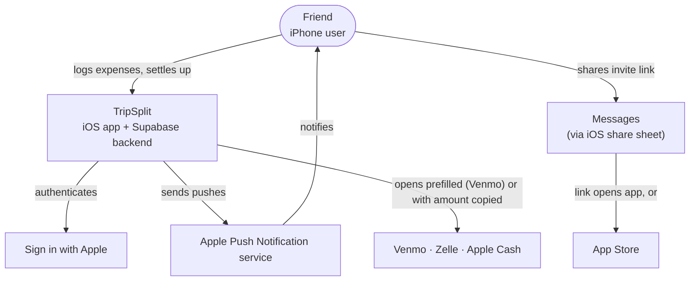
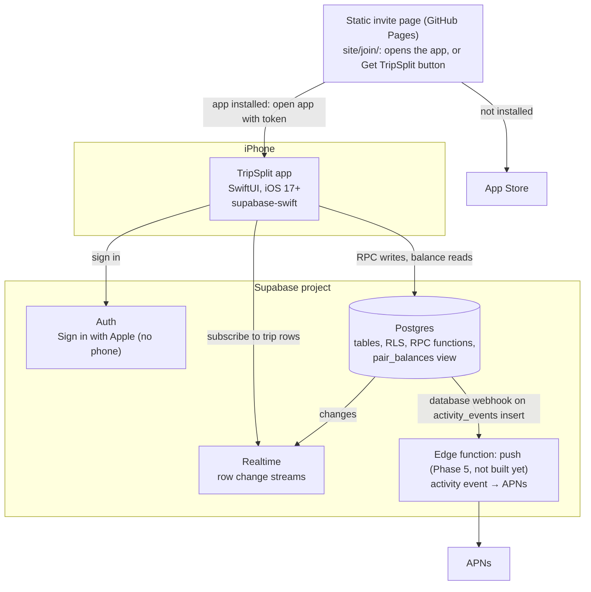

# Architecture

TripSplit is a native iPhone app (SwiftUI, iOS 17+) backed by Supabase. Product rules are in [`prd.md`](../prd.md).

A visual copy of these diagrams lives on the [Architecture & Reference FigJam board](https://www.figma.com/board/3ltxi7OzyIYQM1QjXN5Lhg). The Mermaid in these docs is the source of truth; update it first, then regenerate the board.

## C4 Level 1: System context

Things TripSplit deliberately doesn't do: read contacts, collect phone numbers, move money, or confirm payments with pay apps. Payments count only once logged in TripSplit.

## C4 Level 2: Containers

| Container | Responsibility |
|---|---|
| **iOS app** | All UI. Holds no money logic beyond formatting and live split previews; saved shares and balances come from the server. |
| **Postgres** | Source of truth. RPC functions own every money write (split → shares, payment allocation, wipe). The `pair_balances` view owns every balance read. RLS limits rows to the caller's trips. |
| **Realtime** | Pushes row changes so every member's screens update in close to real time. |
| **Edge function: push** (Phase 5, not built yet) | On each `activity_events` insert, finds affected members (event matrix in [`events.md`](events.md)), checks their preferences, skips the actor, sends APNs. |
| **Static invite page** | `site/join/index.html`, hosted free on GitHub Pages (Supabase's functions domain forces text/plain, so an edge function can't serve it). Kept in sync by hand with the `taytayrad/tripsplit-invite` Pages repo. Reads the token from the URL fragment and opens `tripsplit://join/:token`. Stands in for Universal Links until there's a domain. After an App Store install, the user may need to tap the link again. |

## Key choices

| Choice | Why |
|---|---|
| Money logic in Postgres functions, not the app | One implementation, atomic multi-row writes, and the same results on every client. |
| Balances calculated, never stored | They can't drift from the expenses and payments they come from. |
| Integer cents everywhere | No float rounding. The remainder rule is exact. |
| Online-only saves with Retry | The PRD keeps offline entry out of scope. Simpler than a sync queue. |
| Activity deltas snapshotted at write time | Old Activity rows keep the dollar line they had. |
| No contacts and no phone | The PRD forbids phone numbers. "On TripSplit" lists people you already share a trip with. |

## Related docs

- Schema and write paths: [`data-model.md`](data-model.md)
- Money math and golden cases: [`money-rules.md`](money-rules.md)
- Flows and state diagrams: [`flows.md`](flows.md)
- Access rules: [`permissions.md`](permissions.md)
- Activity and push matrix: [`events.md`](events.md)
- Screens and Figma: [`screen-map.md`](screen-map.md)
