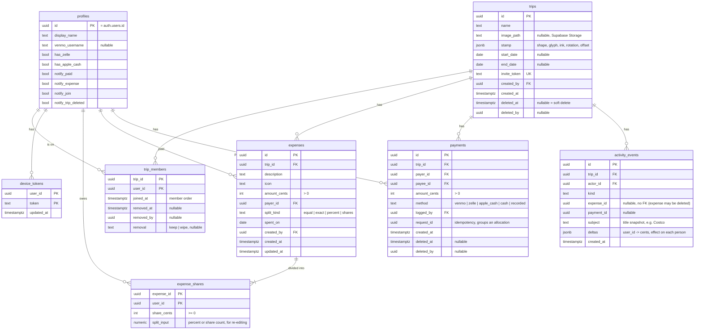

# Data model

The proposed Supabase Postgres schema. **Stored** facts live in tables. **Calculated** values (every balance) are derived by query, never stored, so they can't drift. The math is in [`money-rules.md`](money-rules.md).

## Constraints and invariants

| Rule | Where it's enforced |
|---|---|
| `start_date` and `end_date` are both set or both null, and `end ≥ start` | check constraint |
| A trip has at most 20 active members | trigger on `trip_members` insert |
| `sum(share_cents) = amount_cents` per expense | deferred constraint trigger |
| The payer is a member of the trip; a share's user was a member when the expense was saved | `save_expense` function |
| `payer_id ≠ payee_id`, and `logged_by ∈ {payer_id, payee_id}` | check constraint |
| One allocation per `request_id` | unique `(request_id, trip_id)` |
| Expenses, shares, and payments change only through the functions below | RLS: no direct client insert or update on money tables |
| Activity events are append-only and written only by functions or triggers | RLS |

## Write paths (Postgres functions called over RPC)

Every multi-row money write is one function in one transaction, so invariants hold even on flaky connections.

| Function | Does |
|---|---|
| `create_trip(name, dates, image?)` | inserts trip with generated stamp and invite token, adds creator as member, logs `trip_created` |
| `join_trip(invite_token)` | adds caller as member, or no-op if already a member; logs `member_joined` |
| `save_expense(expense, split_inputs)` | computes shares (remainder rule), inserts or updates expense and shares, logs `expense_added` or `expense_updated` with deltas |
| `delete_expense(id)` | hard-deletes expense and shares, logs `expense_deleted` with deltas |
| `log_payment(other_user, amount, direction, method, request_id)` | rejects amounts above the combined balance in that direction, allocates oldest trip first, inserts one payment per trip, logs `payment_logged` per row |
| `delete_payment(id)` | soft-deletes, logs `payment_deleted` |
| `remove_member(trip, user, keep \| wipe)` | marks removal; for wipe, rewrites shares (see money-rules › Wipe) |
| `delete_trip(id)` / `undelete_trip(id)` | sets or clears `deleted_at`, logs the event |

## Reads (calculated)

| Need | Source |
|---|---|
| Pairwise balances | SQL view `pair_balances(trip_id, user_a, user_b, cents)` over non-deleted trips, expenses, shares, and non-deleted payments |
| Trip net, combined balance, header total | sums over `pair_balances` |
| Activity dollar line | `activity_events.deltas[you]`, snapshotted when the event was written so history doesn't shift after later edits |

## Notes

- **Why deltas are snapshotted:** the PRD calculates the dollar line "from that event's effect on you". Recomputing that effect later, after edits and deletes, would change old Activity rows. A snapshot freezes it.
- **Realtime:** clients subscribe to `expenses`, `expense_shares`, `payments`, `trip_members`, and `activity_events` for their trips, and re-query balances on change.
- **Stamp** is stored, not regenerated, so a trip looks the same on every device.
