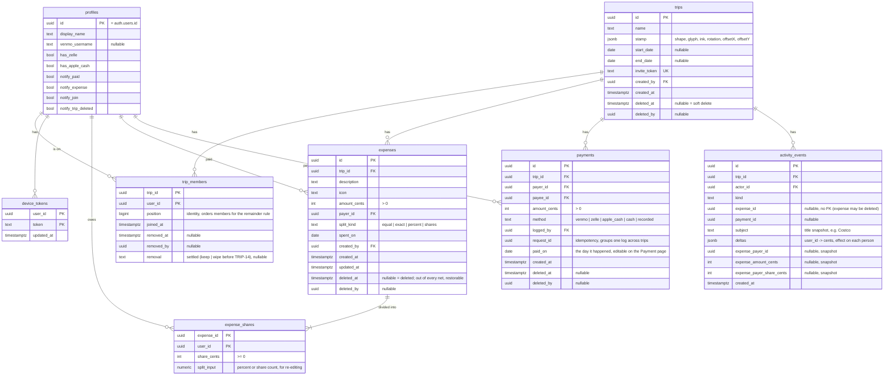

# Data model

The Supabase Postgres schema, implemented through Phase 3, plus Phase 5's `device_tokens` writes (the app upserts this phone's APNs token while notifications are allowed, and deletes it at sign-out; the `push` function arrives later in Phase 5). **Stored** facts live in tables. **Calculated** values (every balance) are derived by query, never stored, so they can't drift. The math is in [`money-rules.md`](money-rules.md).



## Constraints and invariants

| Rule | Where it's enforced |
|---|---|
| `start_date` and `end_date` are both set or both null, and `end ≥ start` | check constraint |
| A trip has at most 20 active members | trigger on `trip_members` insert |
| `sum(share_cents) = amount_cents` per expense | deferred constraint trigger |
| The payer is a member of the trip; a share's user was a member when the expense was saved | `save_expense` function |
| `payer_id ≠ payee_id`, and `logged_by ∈ {payer_id, payee_id}` | check constraint |
| One payment per trip per `request_id` | unique `(request_id, trip_id)` |
| A payment is no more than the payer owes and the payee is owed on that trip | `log_payment` function |
| Someone who left a trip at $0 stays at $0: no expense edit or delete, or payment delete, may move their net | deferred constraint triggers on `expenses`, `expense_shares` and `payments` (`private.check_departed_settled`) |
| Expenses, shares, and payments change only through the functions below | RLS: no direct client insert or update on money tables |
| Activity events are append-only and written only by functions or triggers | RLS |

## Write paths (Postgres functions called over RPC)

Every multi-row money write is one function in one transaction, so invariants hold even on flaky connections.

| Function | Does |
|---|---|
| `create_trip(name, stamp, dates)` | inserts trip with generated stamp and invite token, adds creator as member, logs `trip_created` |
| `join_trip(invite_token)` | adds caller as member, or no-op if already a member; refused for someone removed from the trip; logs `member_joined` |
| `add_member(trip, user)` | adds someone you already share a trip with (including a removed member, who comes back with no share in old expenses); logs `member_joined` |
| `invite_preview(invite_token)` | trip name, inviter, and stamp for the sign-in screen; the one function anon may call |
| `save_expense(expense, split_inputs)` | computes shares (remainder rule), inserts or updates expense and shares, logs `expense_added` or `expense_updated` with deltas |
| `delete_expense(id)` | logs `expense_deleted` with deltas, then sets `deleted_at` (the expense and its shares stay, out of every net). A deleted expense can't be edited (`save_expense` is refused: "restore it first"). Expenses deleted before TRIP-27 were hard-deleted |
| `restore_expense(id)` | any active member of a live trip. Clears `deleted_at` and logs `expense_restored` with deltas. Refused on a deleted trip, and when the payer or anyone in the split is no longer an active member ("someone on this expense left the trip; add them back first"). Restoring one that's already back does nothing |
| `log_payment(other_user, direction, method, request_id, paid_on, parts)` | `direction` is `pay` (you pay them) or `record` (they paid you). `parts` is `[{trip_id, cents}]`: one payment per trip ("2 Trips" sends two). Each part must be no more than the payer owes and the payee is owed on that trip, and both people must be on it. Locks the trips, inserts the rows, logs `payment_logged` per row, and returns them. Retrying a `request_id` returns the existing rows (only to the person who logged it) |
| `delete_payment(id)` | soft-deletes, logs `payment_deleted`; refused on a deleted trip so undelete restores it exactly |
| `remove_member(trip, user)` | removes someone else, only when their net on the trip is $0 ("only members with a $0 balance can be removed"); logs `member_removed` with empty deltas |
| `leave_trip(trip)` | removes you, only when your net is $0 ("settle up before leaving"); logs `member_removed` with you as the actor |
| `delete_trip(id)` / `undelete_trip(id)` | sets or clears `deleted_at`, logs the event |
| `register_device_token(token)` | saves this phone's APNs token for you and removes it from any other account (`token` is unique), so a phone gets one account's pushes at a time |

## Reads (calculated)

| Need | Source |
|---|---|
| Member nets | private view `private.member_nets` → `(trip_id, user_id, cents)` per live trip; `private.member_net(trip, user)` for one |
| Suggested payments | `my_trip_settlements()` → `(trip_id, seq, payer_id, payee_id, cents)`: every suggestion on trips you're an active member of (plus any involving you on a trip you were removed from), in order. Built by `private.suggested_payments(trip)` (money-rules › Suggested payments) |
| Your net per trip | `my_trip_nets()` → `(trip_id, cents)`, from `member_nets` |
| Activity dollar line | `activity_events.deltas[you]`, plus the own-cost snapshot (`expense_payer_id`, `expense_amount_cents`, `expense_payer_share_cents`) when the delta is 0. Both are taken when the event is written, so a later edit does not change an earlier row |

## Notes

- **Why deltas are snapshotted:** the PRD calculates the dollar line "from that event's effect on you". Recomputing that effect later, after edits and deletes, would change old Activity rows. A snapshot freezes it. The own-cost line ("You paid $X") is the case the delta cannot carry, because a zero is dropped, so the payer, amount, and payer's share are snapshotted beside it. Events written before that snapshot have no own-cost line.
- **Realtime:** the publication holds `trips`, `trip_members`, `payments`, and `activity_events`, and the app re-queries on any change. `expenses` and `expense_shares` are left out on purpose: their DELETE events would reach every subscriber. Every change to them writes an `activity_events` row, and that row is the signal.
- **Function privileges:** Postgres grants EXECUTE on new functions to PUBLIC. Every function in `public` is revoked from `public` and `anon`. The functions the app calls are granted to `authenticated` explicitly. The trigger functions (`enforce_member_limit`, `check_share_sum`, `handle_new_user`, `check_departed_settled`, `snapshot_expense_facts`) are revoked from `authenticated` too and run only as triggers. `invite_preview` is the one function `anon` may execute. pgTAP (`005_access`) fails if anything else is callable signed out.
- **Leftover bucket:** the private `trip-photos` storage bucket still exists, empty. Trip photos were removed (stamps only), and Supabase refuses deleting storage rows from SQL, so remove it from the dashboard if you want it gone.
- **Stamp** is stored, not regenerated, so a trip looks the same on every device. Members can change it from Edit trip (a direct column update, like name and dates). Its JSON matches the app's `StampSpec` (`ios/TripSplit/DesignSystem/Stamp.swift`):
  ```json
  {"shape": "ticket", "glyph": "road", "ink": "blue", "rotation": -6.0, "offsetX": 0.02, "offsetY": -0.015}
  ```
  `shape`: ticket, circle, octagon, rounded, hexagon, or postage. `glyph`: road, house, market, plane, palm, mountain, tent, boat, or sun. `ink`: blue, green, red, purple, orange, or teal. `rotation`: degrees, within ±8. `offsetX` and `offsetY`: fractions of the frame, within ±0.025. The app generates it at trip creation, and the server stores it as given.
