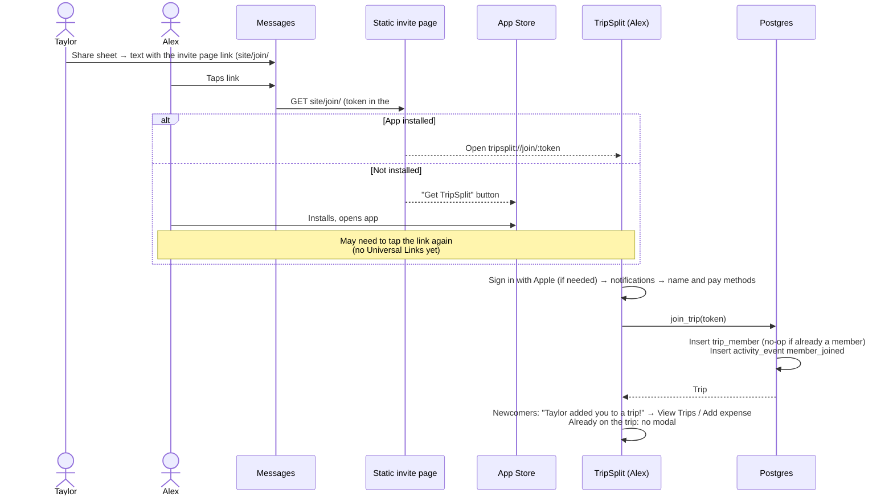
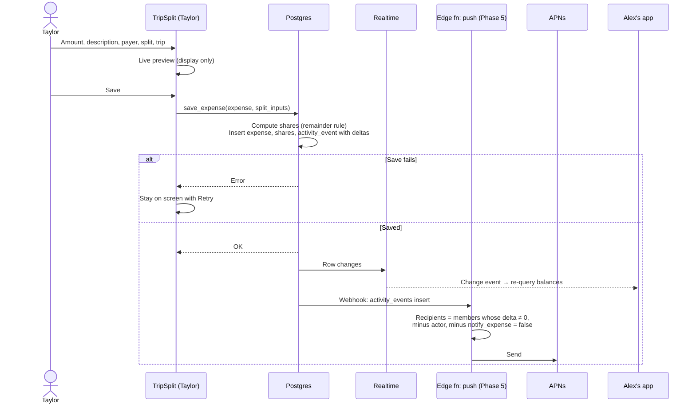
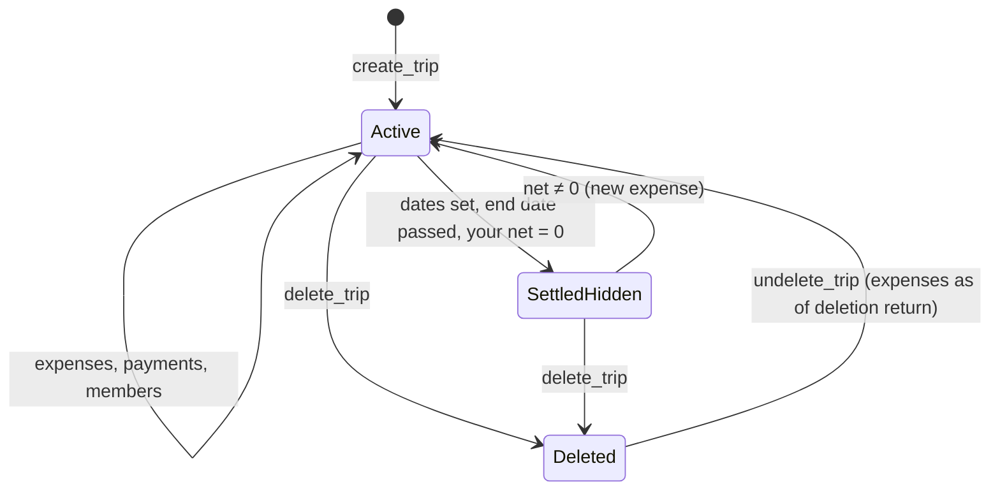
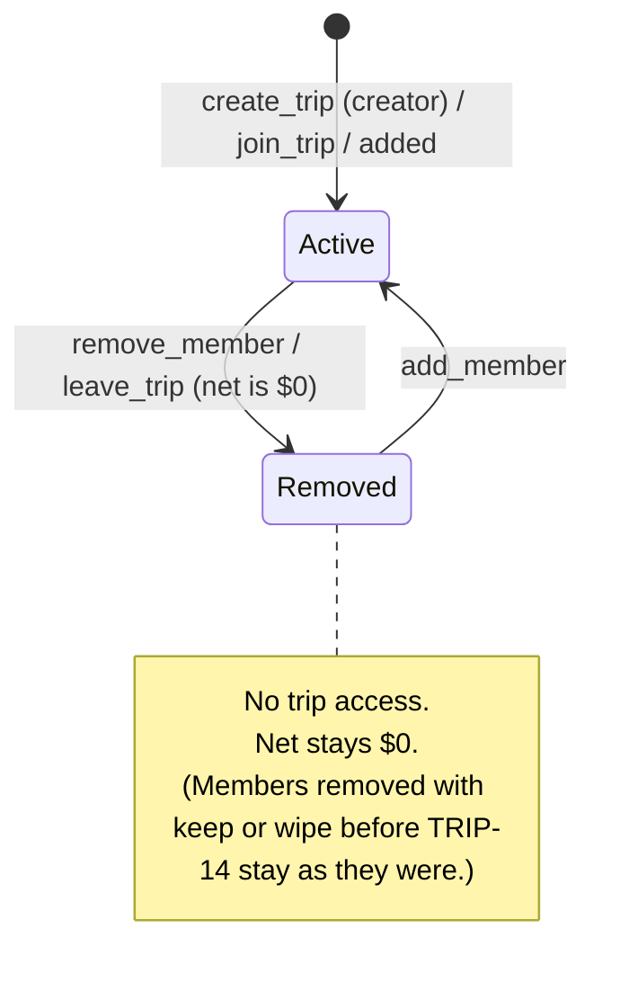
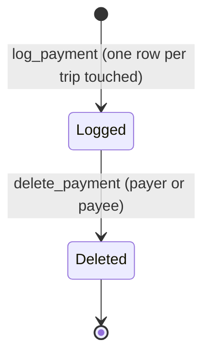

# Flows

Sequence diagrams for the three hardest flows, then the state machines. Function names refer to [`data-model.md`](data-model.md) › Write paths.

## Joining from an invite link



## Adding an expense



## Logging a payment

```mermaid
sequenceDiagram
    actor Y as You
    participant App as TripSplit
    participant Pay as Venmo
    participant DB as Postgres

    Y->>App: Trip detail → Pay → Settle up
    App->>DB: my_trip_settlements() (already loaded)
    Y->>App: Tyler's ticket (You owe $45, 2 trips)
    App->>App: Payment: You → Tyler, $45, 2 Trips, today, Venmo
    Y->>App: Pay $45 with Venmo
    App->>Pay: Open with Tyler + $45
    Y->>Pay: Pays $45
    Y->>App: Returns (nothing logged yet)
    App->>App: Log Payment Sheet "Did you pay Tyler?" $45
    Y->>App: Log $45 payment
    App->>DB: log_payment(Tyler, pay, venmo, request_id, paid_on,<br/>[Lake House 1500, Coast Road 3000])
    DB->>DB: Lock both trips, check each part ≤ what both sides allow<br/>Insert one payment per trip + activity_events
    DB-->>App: Payments
    App->>App: Back on Settle up: the stamp slams onto Tyler's ticket
    Note over App,DB: Retrying with the same request_id<br/>creates nothing new
    Note over Y,App: Apple Cash: a guide sheet first (steps, amount copied),<br/>then Messages; coming back opens the same sheet.<br/>Zelle: amount copied, the sheet opens right away.<br/>Cash and Record log straight from the Payment page.
```

## State machines

### Trip



"SettledHidden" is per viewer. It's calculated, not stored.

### Member



### Payment


