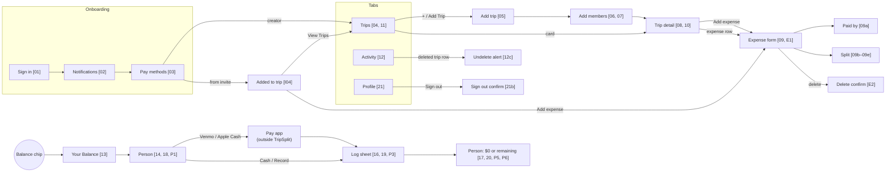

# Screen map

How screens connect. Every screen has a Figma frame on the **Flow** page of the [TripSplit Design System](https://www.figma.com/design/qyUUFgiPUvHGS02kVJMDZD) file. Frame names follow `Feature / State [ref]`. Search Figma for the `[ref]` shown in brackets below.

## Figma sections

| Section | Contents |
|---|---|
| [Onboarding](https://www.figma.com/design/qyUUFgiPUvHGS02kVJMDZD?node-id=42-3485) | Sign in, notifications, pay methods (+ invitee variants) |
| [Invite](https://www.figma.com/design/qyUUFgiPUvHGS02kVJMDZD?node-id=42-3487) | Welcome modal |
| [Trips](https://www.figma.com/design/qyUUFgiPUvHGS02kVJMDZD?node-id=42-3489) | Trips list states |
| [Trip](https://www.figma.com/design/qyUUFgiPUvHGS02kVJMDZD?node-id=42-3491) | Add trip, members, trip detail states |
| [Expense](https://www.figma.com/design/qyUUFgiPUvHGS02kVJMDZD?node-id=42-3493) | Add/edit form, payer, splits, delete |
| [Activity](https://www.figma.com/design/qyUUFgiPUvHGS02kVJMDZD?node-id=42-3495) | Feed, undelete alert |
| [Balance](https://www.figma.com/design/qyUUFgiPUvHGS02kVJMDZD?node-id=42-3497) | Your Balance sheet |
| [Person & Payments](https://www.figma.com/design/qyUUFgiPUvHGS02kVJMDZD?node-id=42-3499) | Person screens, log sheets, settled |
| [Profile](https://www.figma.com/design/qyUUFgiPUvHGS02kVJMDZD?node-id=42-3501) | Profile, sign out |
| [Prototype only](https://www.figma.com/design/qyUUFgiPUvHGS02kVJMDZD?node-id=42-3503) | Stand-ins. **Don't build.** |

## Presentation

| Screen | SwiftUI presentation |
|---|---|
| Trips, Activity, Profile | `TabView` tabs |
| Trip detail, Add members | pushed in `NavigationStack` |
| Add trip, Expense form | `.sheet` with its own `NavigationStack` (payer and split pickers push inside it) |
| Your Balance → Person | `.sheet` with `NavigationStack` (person pushes inside it) |
| Log sheet | `.sheet` with medium detent, over the person screen |
| Welcome modal | `.sheet` or centered overlay after onboarding |
| Delete, undelete, and sign-out confirms | `.alert` |

Sheets and alerts in Figma are drawn as full frames with a dimmed copy of the screen behind. The dim is context, not a layout to build.

## Design tokens and components

The **Color**, **Spacing**, **Radius**, and **Stamp** variable collections carry SwiftUI code syntax (Dev Mode shows `Color.tsOwe`, `Spacing.lg`, and so on). Text styles map to Dynamic Type styles in their descriptions. Native controls (tab bar, segmented control, switch, keyboard) come from the iOS 26 kit. Use the system versions, not custom ones.
