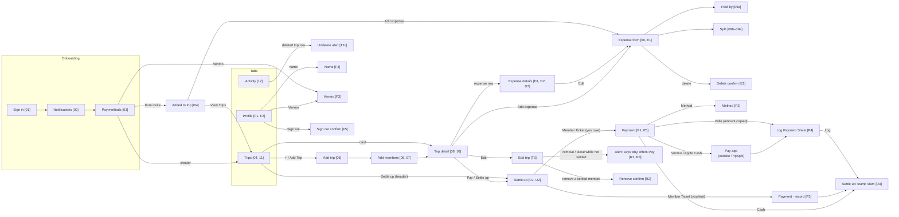

# Screen map

How screens connect. Money screens (Trip detail, Settle up, Payment, Edit trip, remove and leave) are on the [**Flow · Net model**](https://www.figma.com/design/qyUUFgiPUvHGS02kVJMDZD?node-id=179-29) page; everything else is on the **Flow (current build)** page of the [TripSplit Design System](https://www.figma.com/design/qyUUFgiPUvHGS02kVJMDZD) file. Frame names follow `Feature / State [ref]`. Search Figma for the `[ref]` shown in brackets below.

## Figma sections

Net model page [Flow · Net model](https://www.figma.com/design/qyUUFgiPUvHGS02kVJMDZD?node-id=179-29): [Trip](https://www.figma.com/design/qyUUFgiPUvHGS02kVJMDZD?node-id=179-30) (T1–T3), [Settle up](https://www.figma.com/design/qyUUFgiPUvHGS02kVJMDZD?node-id=179-32) (U1–U3), [Payment](https://www.figma.com/design/qyUUFgiPUvHGS02kVJMDZD?node-id=179-34) (P1–P5), [Remove & leave](https://www.figma.com/design/qyUUFgiPUvHGS02kVJMDZD?node-id=179-36) (R1–R3), [Expense details](https://www.figma.com/design/qyUUFgiPUvHGS02kVJMDZD?node-id=271-1018) (D1–D7; D3–D6 are restore, TRIP-27).

Flow (current build) page:

| Section | Contents |
|---|---|
| [Onboarding](https://www.figma.com/design/qyUUFgiPUvHGS02kVJMDZD?node-id=42-3485) | Sign in, notifications, pay methods (+ invitee variants) |
| [Invite](https://www.figma.com/design/qyUUFgiPUvHGS02kVJMDZD?node-id=42-3487) | Welcome modal |
| [Trips](https://www.figma.com/design/qyUUFgiPUvHGS02kVJMDZD?node-id=42-3489) | Trips list states |
| [Trip](https://www.figma.com/design/qyUUFgiPUvHGS02kVJMDZD?node-id=42-3491) | Add trip, members, trip detail states |
| [Expense](https://www.figma.com/design/qyUUFgiPUvHGS02kVJMDZD?node-id=42-3493) | Add/edit form, payer, splits, delete |
| [Activity](https://www.figma.com/design/qyUUFgiPUvHGS02kVJMDZD?node-id=42-3495) | Feed, undelete alert |
| [Balance](https://www.figma.com/design/qyUUFgiPUvHGS02kVJMDZD?node-id=42-3497) | Your Balance sheet. **Retired (TRIP-13)**; don't build. |
| [Person & Payments](https://www.figma.com/design/qyUUFgiPUvHGS02kVJMDZD?node-id=42-3499) | Person screens, log sheets, settled. **Retired (TRIP-13)**; the Log Payment Sheet component is still used. |
| [Profile](https://www.figma.com/design/qyUUFgiPUvHGS02kVJMDZD?node-id=42-3501) | **Retired (TRIP-22)**; build from Flow · Net model › [Profile](https://www.figma.com/design/qyUUFgiPUvHGS02kVJMDZD?node-id=297-1283) (F1–F8) |
| [Prototype only](https://www.figma.com/design/qyUUFgiPUvHGS02kVJMDZD?node-id=42-3503) | Stand-ins. **Don't build.** |

## Presentation

| Screen | SwiftUI presentation |
|---|---|
| Trips, Activity, Profile | `TabView` tabs |
| Trip detail, Add members, Expense details | pushed in `NavigationStack` (Expense details' Edit opens the Expense form sheet) |
| Add trip, Expense form | `.sheet` with its own `NavigationStack` (payer and split pickers push inside it) |
| Apple Cash guide | `.sheet` (large, scrolls) over the Payment page; Open Messages leaves for the Messages app, and coming back opens the Log Payment Sheet |
| Log Payment Sheet | `.sheet` with medium detent, over the Payment page, when you come back from a pay app |
| Settle up, Payment, Method | pushed in the trip's `NavigationStack`; Method is a pushed list |
| Remove, leave confirms and blocked alerts | `.alert` over Edit trip |
| Welcome modal | `.sheet` or centered overlay after onboarding |
| Delete, undelete, and sign-out confirms | `.alert` |

Sheets and alerts in Figma are drawn as full frames with a dimmed copy of the screen behind. The dim is context, not a layout to build.

## Design tokens and components

The **Color**, **Spacing**, **Radius**, and **Stamp** variable collections carry SwiftUI code syntax (Dev Mode shows `Color.tsOwe`, `Spacing.lg`, and so on). Text styles map to Dynamic Type styles in their descriptions. Native controls (tab bar, segmented control, switch, keyboard) come from the iOS 26 kit. Use the system versions, not custom ones.

Net model components: **Member Ticket** (Money Rows page; Kind = You owe / You lent / Settled, with Two trips and More trips switches for a person across trips) and **Route** (Payments page, formerly Pay Bar). Balance Chip, Person Row and Pay Bar were deleted with TRIP-13; the retired frames on the Flow (current build) page keep detached copies. Main Header is Settle up (left) and Add (right).
